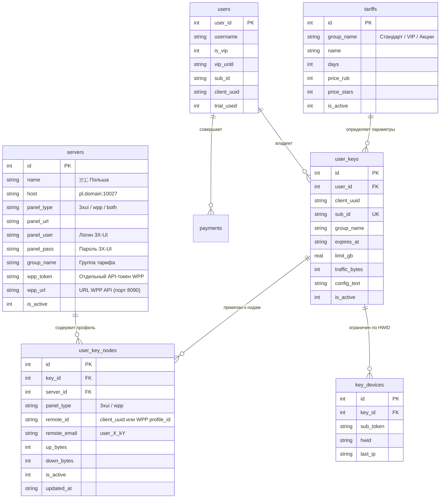
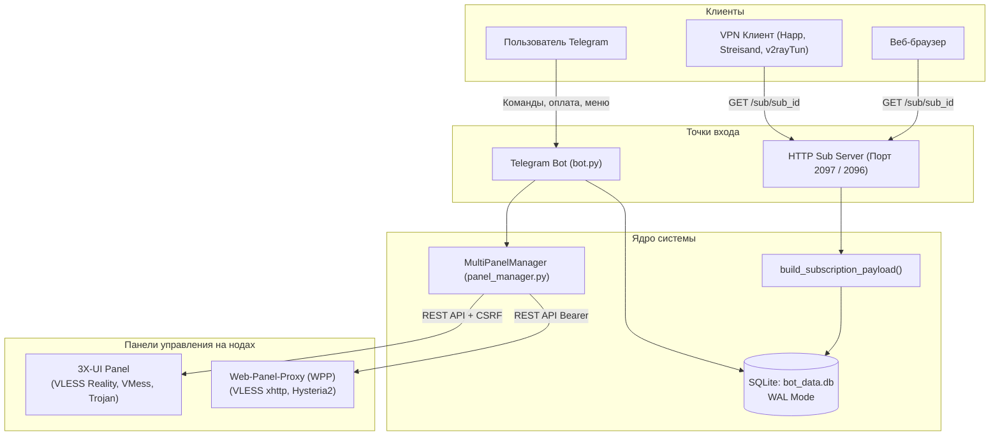
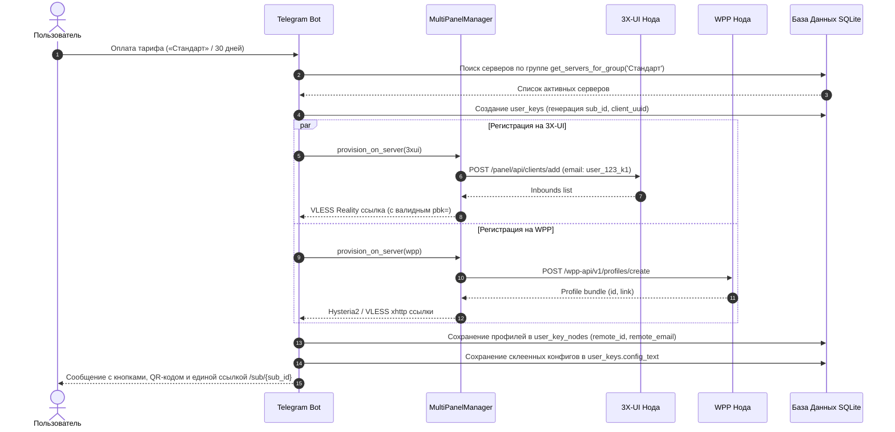
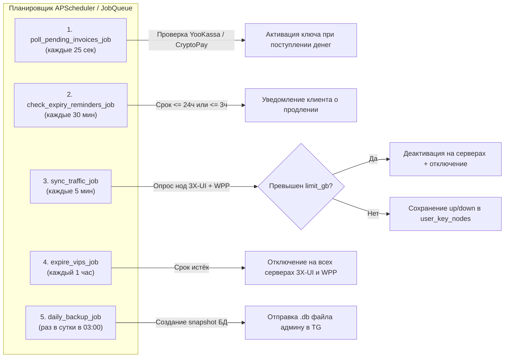

# 🗺️ Маршрутный лист и архитектурная карта проекта `Bot_VIP`

> [!NOTE]
> Данный документ является генеральным планом и технической картой мульти-панельного VPN-бота `Bot_VIP`. В нём зафиксированы цели проекта, структура файлов, зоны ответственности каждого модуля, схема базы данных и сквозные потоки данных.

---

## 1. Чего мы добиваемся (Глобальная цель и видение)

Главная цель проекта — создание **отказоустойчивого, полностью автономного коммерческого VPN-бота** с гибридной архитектурой нового поколения:

1. **Мульти-панельная гибридная выдача (`3X-UI` + `WPP`):**
   - Пользователь покупает один тариф и получает **одну ссылку подписки** (`/sub/{sub_id}`), которая объединяет серверы классического Xray (через 3X-UI: VLESS Reality, VMess, Trojan) и прокси-панели Web-Panel-Proxy (через WPP: VLESS xhttp, Hysteria2).
   - Если провайдер пользователя блокирует один протокол (например, TCP/TLS), клиентское приложение автоматически переключается на альтернативный (например, UDP Hysteria2 или HTTP/3).

2. **Строгая привязка серверов к тарифам (Матрица «Тариф $\rightarrow$ Серверы»):**
   - Разделение серверов по группам («Стандарт», «VIP», «VPN + Proxy», «Акции»).
   - Клиент тарифа «Стандарт» получает доступ только к стандартным нодам, а VIP-клиент — ко всем приоритетным серверам. При этом предусмотрен безопасный фоллбэк: если под группу нет выделенной ноды, бот не падает, а выдает базовые рабочие сервера.

3. **Сквозная отказоустойчивость (Fault Tolerance):**
   - Ни при каких обстоятельствах падение, перезагрузка или сетевой таймаут отдельной ноды (3X-UI или WPP) не должны приводить к ошибкам HTTP 500 для пользователя или сбою фоновых задач планировщика.
   - Недоступные ноды мягко пропускаются, отдаются рабочие конфигурации, а трафик подтягивается из локального кэша SQLite.

4. **Автономный жизненный цикл клиента:**
   - Автоматический прием оплат (Telegram Stars, YooKassa, CryptoPay, СБП/карты).
   - Мгновенная регистрация клиента на всех серверах тарифа через REST API.
   - Фоновый мониторинг трафика каждые 5 минут и суммирование объемов с обеих панелей.
   - Предупреждения об окончании срока (за 24ч и за 3ч).
   - Автоматическое отключение на удаленных нодах при исчерпании лимита гигабайт или истечении срока.
   - Защита от передачи ссылки третьим лицам через ограничение HWID устройств.

---

## 2. Что где лежит (Файловая структура проекта)

Рабочая директория проекта: `C:\Users\PC\Desktop\BotAnti\Bot_VIP`

```
Bot_VIP/
│
├── ⚙️ ЯДРО И БОТ
│   ├── bot.py                     # Основное приложение: Telegram-бот, планировщик задач, Sub-сервер
│   ├── .env                       # Конфигурация окружения (токены, порты, ID админа, ключи WPP)
│   ├── .env.example               # Шаблон файла окружения
│   ├── requirements.txt           # Список Python-зависимостей проекта
│   └── start_bot.bat              # Скрипт быстрого запуска бота для Windows
│
├── 🌐 МУЛЬТИ-ПАНЕЛЬ И СЕТЬ
│   ├── panel_manager.py           # MultiPanelManager: фасад для 3X-UI и WPP, генератор ссылок Reality
│   ├── wpp_client.py              # Асинхронный HTTPX-клиент для API Web-Panel-Proxy (WPP)
│   ├── sub_server.py              # Единый генератор подписки (/sub/{sub_id}) для приложений и браузеров
│   ├── sub_dashboard.py           # Генератор адаптивного HTML-дашборда веб-подписки
│   └── sub_service.py             # Сервисный слой формирования подписок и QR-кодов
│
├── 🗄️ БАЗА ДАННЫХ И ХРАНИЛИЩЕ
│   ├── bot_data.db                # Основная SQLite база данных (WAL-режим, таймаут 30с)
│   ├── migrate_db.py              # Скрипты ручной миграции БД
│   └── backup_manager.py          # Автоматическое и ручное резервное копирование SQLite БД
│
├── 💳 ПЛАТЕЖИ И ФИНАНСЫ
│   ├── autopay.py                 # Проверка счетов YooKassa и CryptoPay в фоновом режиме
│   └── payment_cards.py           # Управление ручными реквизитами для оплат картой / СБП
│
├── 🎛️ АДМИНИСТРИРОВАНИЕ И ВИЗАРДЫ
│   ├── server_wizard.py           # Интерактивный визард добавления/настройки серверов в Telegram
│   ├── tariff_wizard.py           # Интерактивный визард создания/редактирования тарифов
│   └── staff_roles.py             # Разграничение прав персонала (Администраторы, Модераторы, Dev)
│
├── 🧪 ТЕСТИРОВАНИЕ И ОТЛАДКА
│   ├── test_system.py             # Автономный комплексный смоук-тест (15 тестов)
│   ├── bot.log                    # Лог-файл работы основного процесса бота
│   └── sub_server.log             # Лог-файл внешнего HTTP-сервера подписок
│
└── 🐧 РАЗВЁРТЫВАНИЕ НА LINUX
    ├── install.sh                 # Скрипт первичной авто-установки бота на Linux VPS
    ├── backup_job.sh              # Bash-скрипт бэкапа по cron
    └── update_v2.tar.gz           # Архив релизного обновления
```

---

## 3. Что за что отвечает (Компоненты и зоны ответственности)

| Файл / Модуль | Основная зона ответственности |
|---|---|
| [bot.py](file:///C:/Users/PC/Desktop/BotAnti/Bot_VIP/bot.py) | **Сердце проекта.** Запуск Telegram Application, меню клиентов и админки, встроенный сервер подписок на порту 2096, регистрация 5 фоновых задач, авто-миграция БД при старте, обработка оплат (Stars, YooKassa, CryptoPay). |
| [panel_manager.py](file:///C:/Users/PC/Desktop/BotAnti/Bot_VIP/panel_manager.py) | **Мульти-панельный фасад (`MultiPanelManager`).** Добавление клиентов, сбор трафика и отключение на 3X-UI и WPP. Парсинг инбаундов Xray, корректное извлечение Reality `pbk` и фильтрация служебных нод. |
| [wpp_client.py](file:///C:/Users/PC/Desktop/BotAnti/Bot_VIP/wpp_client.py) | **Клиент WPP.** Асинхронные HTTPX-запросы к `/wpp-api/v1/profiles/*`. Управление токенами авторизации, формирование Bearer-заголовков, защита от ошибок 401 и маскированное логирование. |
| [sub_server.py](file:///C:/Users/PC/Desktop/BotAnti/Bot_VIP/sub_server.py) | **Единый генератор подписки.** Функция `build_subscription_payload()`. Отдает Base64 с заголовками `Subscription-Userinfo` для VPN-клиентов и HTML-дашборд для браузеров. Проверяет HWID-лимит устройств. |
| [sub_dashboard.py](file:///C:/Users/PC/Desktop/BotAnti/Bot_VIP/sub_dashboard.py) | **Интерфейс веб-кабинета.** Красивый Web-UI, отображающий остаток трафика, статус ключа, дату окончания, QR-код подписки и кнопки копирования ссылок. |
| [test_system.py](file:///C:/Users/PC/Desktop/BotAnti/Bot_VIP/test_system.py) | **Система контроля качества.** Автоматический аудит БД, матрицы тарифов, ссылки Reality, WPP-авторизации, отдачи подписки и 5 фоновых задач. |
| [server_wizard.py](file:///C:/Users/PC/Desktop/BotAnti/Bot_VIP/server_wizard.py) | **Мастер серверов.** Пошаговое добавление нод в Telegram: хост, тип панели (3x-ui, wpp, both), URL панели, логин, пароль, группа. |
| [autopay.py](file:///C:/Users/PC/Desktop/BotAnti/Bot_VIP/autopay.py) | **Атомарный биллинг.** Проверка статусов инвойсов YooKassa/CryptoPay с защитой от повторного начисления подписки (атомарное списание инвойса). |

---

## 4. Схема базы данных SQLite (`bot_data.db`)

База данных работает в высокопроизводительном режиме **WAL (Write-Ahead Logging)** с таймаутом ожидания блокировки `busy_timeout = 30000` мс.



---

## 5. Архитектура и сквозные потоки данных

### 5.1. Общая схема взаимодействия компонентов



---

### 5.2. Жизненный цикл покупки и выдачи подписки



---

### 5.3. Цикл фонового обслуживания (5 задач планировщика)



---

## 6. Текущий статус готовности и чек-лист

### ✅ Что уже полностью сделано и протестировано:
- [x] **Этап 1:** Исправлен баг генерации Reality `pbk=` в 3X-UI (глубокий разбор `streamSettings`).
- [x] **Этап 2:** Проведён ресёрч WPP API, устранены синхронные блокировки потока, написан асинхронный клиент.
- [x] **Этап 3:** Создан единый агрегатор `build_subscription_payload`, объединяющий конфиги и отдающий Base64 клиентам и Web-UI браузерам.
- [x] **Этап 4:** Внедрена таблица `user_key_nodes`, матрица «Тариф $\rightarrow$ Серверы», 5-я фоновая задача `sync_traffic_job` и деактивация в `expire_vips_job`.
- [x] **Отладка WPP:** Исправлена ошибка `401 Unauthorized`: токен WPP изолирован от пароля 3X-UI при `panel_type = 'both'`.
- [x] **Тестирование:** Скрипт `test_system.py` подтвердил 15/15 успешных тестов.

### 📋 Что осталось сделать при переносе на боевой сервер (Production):
1. **Синхронизация файлов на VPS:**
   - Скопировать обновленные `bot.py`, `panel_manager.py`, `wpp_client.py`, `sub_server.py`, `test_system.py` на сервер в `/opt/Bot_VIP/`.
2. **Проверка реквизитов WPP в `.env`:**
   - Убедиться, что в `/opt/Bot_VIP/.env` прописан реальный токен WPP панели (`WPP_API_KEY=...`).
3. **Проверка Caddy:**
   - Убедиться, что Caddy проксирует `/sub/*` на порт `2097`, а `/wpp-api/*` — на порт `8090`.
4. **Тестовый прогон `python3 test_system.py` на VPS:**
   - Запустить скрипт прямо на Linux сервере для финального подтверждения связи с локальными демонами 3X-UI и WPP.
